# MINDANAO STATE UNIVERSITY — ILIGAN INSTITUTE OF TECHNOLOGY
**COLLEGE OF COMPUTER STUDIES · DEPARTMENT OF COMPUTER APPLICATIONS**

**BCA151 Operating Systems Lab**

| | |
|---|---|
| **Name** | _Miche Louie B. Acompañado_ |
| **Date** | _October 29, 2026_ |
| **Course & Year** | _BSCA 3RD YEAR_ |

# Lab Activity 2 — CPU Scheduling Algorithms

---

## 1. GitHub Repository Link

**Repository:** _https://github.com/michelouieacompanado-prog/OS-Laboratory-2-CPU-Scheduling_

---

## 2. Introduction

CPU scheduling is the operating system function that decides which process in the ready queue gets the CPU next. The rule used affects waiting time, turnaround time, response time and overall system responsiveness. In this activity a CPU Scheduling Simulator was written in Python and run in GitHub Codespaces. It implements five algorithms: First-Come First-Served (FCFS), non-preemptive Shortest Job First (SJF), non-preemptive Priority Scheduling, Round Robin (RR, time quantum 2 ms) and preemptive Shortest Remaining Time First (SRTF).

**Formulas used**

| Metric | Formula |
|---|---|
| Turnaround Time (TAT) | TAT = CT − AT |
| Waiting Time (WT) | WT = TAT − BT |
| Response Time (RT) | RT = First CPU Start − AT |
| Average metric | Sum of metric values ÷ number of processes |

---

## 3. Datasets

**Original dataset** (FCFS, SJF, Priority, Round Robin). A smaller priority number means a higher priority.

| Process | Arrival Time (AT) | Burst Time (BT) | Priority |
|---|---|---|---|
| P1 | 0 | 8 | 2 |
| P2 | 0 | 4 | 1 |
| P3 | 0 | 2 | 4 |
| P4 | 0 | 6 | 3 |

**Separate SRTF dataset** (different arrival times so preemption can be seen):

| Process | Arrival Time (AT) | Burst Time (BT) | Priority |
|---|---|---|---|
| P1 | 0 | 8 | 2 |
| P2 | 1 | 4 | 1 |
| P3 | 2 | 2 | 4 |
| P4 | 3 | 1 | 3 |

---

## 4. Source Code

The complete program is in the repository file `cpu_scheduling.py`.

See [cpu_scheduling.py](cpu_scheduling.py) in the repository.

---

## 5. Part C — Program Running in GitHub Codespaces

Command used: `python3 cpu_scheduling.py`

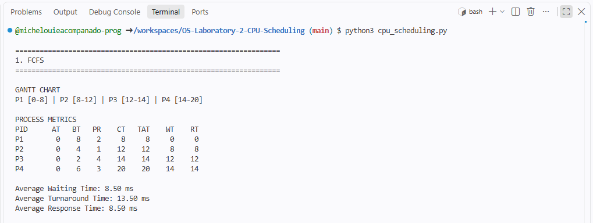

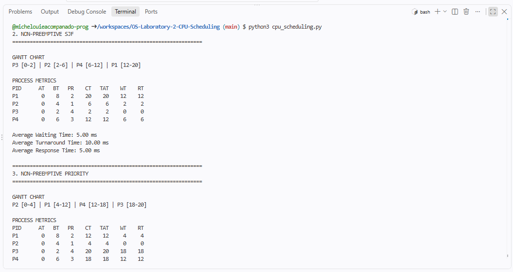

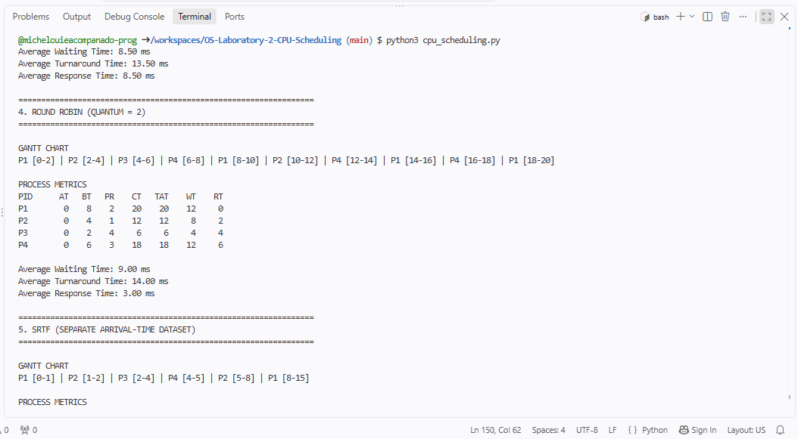

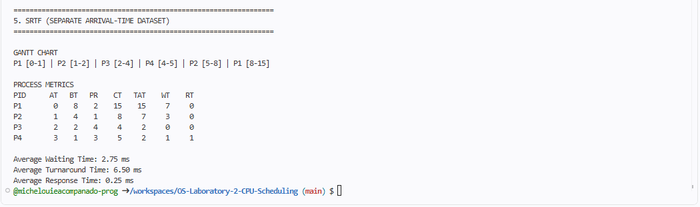

**Average results from the program (original dataset; SRTF uses its own dataset):**

| Algorithm | Average WT | Average TAT | Average RT |
|---|---|---|---|
| FCFS | 8.50 ms | 13.50 ms | 8.50 ms |
| Non-preemptive SJF | 5.00 ms | 10.00 ms | 5.00 ms |
| Non-preemptive Priority | 8.50 ms | 13.50 ms | 8.50 ms |
| Round Robin (q = 2) | 9.00 ms | 14.00 ms | 3.00 ms |
| SRTF (separate dataset) | 2.75 ms | 6.50 ms | 0.25 ms |

These values match the reference results in the laboratory sheet for the first four algorithms.

---

## 6. Part D — Manual Verification (Gantt Charts and Calculations)

How to read a Gantt chart: each box is a time the CPU spent running that process, and the numbers below the boxes are the clock times when each run starts and ends.

### 6.1 FCFS

**Execution order:** P1 → P2 → P3 → P4

**Gantt chart:**

```
+-----+-----+-----+-----+
| P1  | P2  | P3  | P4  |
+-----+-----+-----+-----+
0     8     12    14    20
```

Segments: P1 [0-8] | P2 [8-12] | P3 [12-14] | P4 [14-20]

**Manual calculation (compare with the program output):**

- **P1**: CT = 8; TAT = CT − AT = 8 − 0 = 8; WT = TAT − BT = 8 − 8 = 0; RT = First Start − AT = 0 − 0 = 0
- **P2**: CT = 12; TAT = CT − AT = 12 − 0 = 12; WT = TAT − BT = 12 − 4 = 8; RT = First Start − AT = 8 − 0 = 8
- **P3**: CT = 14; TAT = CT − AT = 14 − 0 = 14; WT = TAT − BT = 14 − 2 = 12; RT = First Start − AT = 12 − 0 = 12
- **P4**: CT = 20; TAT = CT − AT = 20 − 0 = 20; WT = TAT − BT = 20 − 6 = 14; RT = First Start − AT = 14 − 0 = 14

**Average WT** = (0 + 8 + 12 + 14) ÷ 4 = **8.50 ms**  
**Average TAT** = (8 + 12 + 14 + 20) ÷ 4 = **13.50 ms**  
**Average RT** = (0 + 8 + 12 + 14) ÷ 4 = **8.50 ms**

| Process | AT | BT | Priority | CT | TAT | WT | RT |
|---|---|---|---|---|---|---|---|
| P1 | 0 | 8 | 2 | 8 | 8 | 0 | 0 |
| P2 | 0 | 4 | 1 | 12 | 12 | 8 | 8 |
| P3 | 0 | 2 | 4 | 14 | 14 | 12 | 12 |
| P4 | 0 | 6 | 3 | 20 | 20 | 14 | 14 |

**Check:** the required order for FCFS is P1 → P2 → P3 → P4 ✅ — processes run in arrival order, and ties (all AT = 0) are broken by process ID.

### 6.2 Non-preemptive SJF

**Execution order:** P3 → P2 → P4 → P1

**Gantt chart:**

```
+-----+-----+-----+-----+
| P3  | P2  | P4  | P1  |
+-----+-----+-----+-----+
0     2     6     12    20
```

Segments: P3 [0-2] | P2 [2-6] | P4 [6-12] | P1 [12-20]

**Manual calculation (compare with the program output):**

- **P1**: CT = 20; TAT = CT − AT = 20 − 0 = 20; WT = TAT − BT = 20 − 8 = 12; RT = First Start − AT = 12 − 0 = 12
- **P2**: CT = 6; TAT = CT − AT = 6 − 0 = 6; WT = TAT − BT = 6 − 4 = 2; RT = First Start − AT = 2 − 0 = 2
- **P3**: CT = 2; TAT = CT − AT = 2 − 0 = 2; WT = TAT − BT = 2 − 2 = 0; RT = First Start − AT = 0 − 0 = 0
- **P4**: CT = 12; TAT = CT − AT = 12 − 0 = 12; WT = TAT − BT = 12 − 6 = 6; RT = First Start − AT = 6 − 0 = 6

**Average WT** = (12 + 2 + 0 + 6) ÷ 4 = **5.00 ms**  
**Average TAT** = (20 + 6 + 2 + 12) ÷ 4 = **10.00 ms**  
**Average RT** = (12 + 2 + 0 + 6) ÷ 4 = **5.00 ms**

| Process | AT | BT | Priority | CT | TAT | WT | RT |
|---|---|---|---|---|---|---|---|
| P1 | 0 | 8 | 2 | 20 | 20 | 12 | 12 |
| P2 | 0 | 4 | 1 | 6 | 6 | 2 | 2 |
| P3 | 0 | 2 | 4 | 2 | 2 | 0 | 0 |
| P4 | 0 | 6 | 3 | 12 | 12 | 6 | 6 |

**Check:** the required order for SJF is P3 → P2 → P4 → P1 ✅ — the shortest burst (2, then 4, then 6, then 8) runs first and each job runs until it finishes.

### 6.3 Non-preemptive Priority

**Execution order:** P2 → P1 → P4 → P3

**Gantt chart:**

```
+-----+-----+-----+-----+
| P2  | P1  | P4  | P3  |
+-----+-----+-----+-----+
0     4     12    18    20
```

Segments: P2 [0-4] | P1 [4-12] | P4 [12-18] | P3 [18-20]

**Manual calculation (compare with the program output):**

- **P1**: CT = 12; TAT = CT − AT = 12 − 0 = 12; WT = TAT − BT = 12 − 8 = 4; RT = First Start − AT = 4 − 0 = 4
- **P2**: CT = 4; TAT = CT − AT = 4 − 0 = 4; WT = TAT − BT = 4 − 4 = 0; RT = First Start − AT = 0 − 0 = 0
- **P3**: CT = 20; TAT = CT − AT = 20 − 0 = 20; WT = TAT − BT = 20 − 2 = 18; RT = First Start − AT = 18 − 0 = 18
- **P4**: CT = 18; TAT = CT − AT = 18 − 0 = 18; WT = TAT − BT = 18 − 6 = 12; RT = First Start − AT = 12 − 0 = 12

**Average WT** = (4 + 0 + 18 + 12) ÷ 4 = **8.50 ms**  
**Average TAT** = (12 + 4 + 20 + 18) ÷ 4 = **13.50 ms**  
**Average RT** = (4 + 0 + 18 + 12) ÷ 4 = **8.50 ms**

| Process | AT | BT | Priority | CT | TAT | WT | RT |
|---|---|---|---|---|---|---|---|
| P1 | 0 | 8 | 2 | 12 | 12 | 4 | 4 |
| P2 | 0 | 4 | 1 | 4 | 4 | 0 | 0 |
| P3 | 0 | 2 | 4 | 20 | 20 | 18 | 18 |
| P4 | 0 | 6 | 3 | 18 | 18 | 12 | 12 |

**Check:** the required order for Priority is P2 → P1 → P4 → P3 ✅ — priority 1 runs first, then 2, 3 and 4 (a smaller number means a higher priority).

### 6.4 Round Robin (quantum = 2 ms)

**Execution order:** P1 → P2 → P3 → P4 → P1 → P2 → P4 → P1 → P4 → P1

**Gantt chart:**

```
+-----+-----+-----+-----+-----+-----+-----+-----+-----+-----+
| P1  | P2  | P3  | P4  | P1  | P2  | P4  | P1  | P4  | P1  |
+-----+-----+-----+-----+-----+-----+-----+-----+-----+-----+
0     2     4     6     8     10    12    14    16    18    20
```

Segments: P1 [0-2] | P2 [2-4] | P3 [4-6] | P4 [6-8] | P1 [8-10] | P2 [10-12] | P4 [12-14] | P1 [14-16] | P4 [16-18] | P1 [18-20]

**Manual calculation (compare with the program output):**

- **P1**: CT = 20; TAT = CT − AT = 20 − 0 = 20; WT = TAT − BT = 20 − 8 = 12; RT = First Start − AT = 0 − 0 = 0
- **P2**: CT = 12; TAT = CT − AT = 12 − 0 = 12; WT = TAT − BT = 12 − 4 = 8; RT = First Start − AT = 2 − 0 = 2
- **P3**: CT = 6; TAT = CT − AT = 6 − 0 = 6; WT = TAT − BT = 6 − 2 = 4; RT = First Start − AT = 4 − 0 = 4
- **P4**: CT = 18; TAT = CT − AT = 18 − 0 = 18; WT = TAT − BT = 18 − 6 = 12; RT = First Start − AT = 6 − 0 = 6

**Average WT** = (12 + 8 + 4 + 12) ÷ 4 = **9.00 ms**  
**Average TAT** = (20 + 12 + 6 + 18) ÷ 4 = **14.00 ms**  
**Average RT** = (0 + 2 + 4 + 6) ÷ 4 = **3.00 ms**

| Process | AT | BT | Priority | CT | TAT | WT | RT |
|---|---|---|---|---|---|---|---|
| P1 | 0 | 8 | 2 | 20 | 20 | 12 | 0 |
| P2 | 0 | 4 | 1 | 12 | 12 | 8 | 2 |
| P3 | 0 | 2 | 4 | 6 | 6 | 4 | 4 |
| P4 | 0 | 6 | 3 | 18 | 18 | 12 | 6 |

**Check:** every process gets at most 2 ms per turn, and a process that is not finished goes to the **end** of the ready queue:

| Time | Runs | Remaining after turn | Queue afterwards |
|---|---|---|---|
| 0–2 | P1 | 6 | P2, P3, P4, P1 |
| 2–4 | P2 | 2 | P3, P4, P1, P2 |
| 4–6 | P3 | 0 (done) | P4, P1, P2 |
| 6–8 | P4 | 4 | P1, P2, P4 |
| 8–10 | P1 | 4 | P2, P4, P1 |
| 10–12 | P2 | 0 (done) | P4, P1 |
| 12–14 | P4 | 2 | P1, P4 |
| 14–16 | P1 | 2 | P4, P1 |
| 16–18 | P4 | 0 (done) | P1 |
| 18–20 | P1 | 0 (done) | — |

### 6.5 SRTF (preemptive, separate dataset)

**Execution order:** P1 → P2 → P3 → P4 → P2 → P1

**Gantt chart:**

```
+-----+-----+-----+-----+-----+-----+
| P1  | P2  | P3  | P4  | P2  | P1  |
+-----+-----+-----+-----+-----+-----+
0     1     2     4     5     8     15
```

Segments: P1 [0-1] | P2 [1-2] | P3 [2-4] | P4 [4-5] | P2 [5-8] | P1 [8-15]

**Manual calculation (compare with the program output):**

- **P1**: CT = 15; TAT = CT − AT = 15 − 0 = 15; WT = TAT − BT = 15 − 8 = 7; RT = First Start − AT = 0 − 0 = 0
- **P2**: CT = 8; TAT = CT − AT = 8 − 1 = 7; WT = TAT − BT = 7 − 4 = 3; RT = First Start − AT = 1 − 1 = 0
- **P3**: CT = 4; TAT = CT − AT = 4 − 2 = 2; WT = TAT − BT = 2 − 2 = 0; RT = First Start − AT = 2 − 2 = 0
- **P4**: CT = 5; TAT = CT − AT = 5 − 3 = 2; WT = TAT − BT = 2 − 1 = 1; RT = First Start − AT = 4 − 3 = 1

**Average WT** = (7 + 3 + 0 + 1) ÷ 4 = **2.75 ms**  
**Average TAT** = (15 + 7 + 2 + 2) ÷ 4 = **6.50 ms**  
**Average RT** = (0 + 0 + 0 + 1) ÷ 4 = **0.25 ms**

| Process | AT | BT | Priority | CT | TAT | WT | RT |
|---|---|---|---|---|---|---|---|
| P1 | 0 | 8 | 2 | 15 | 15 | 7 | 0 |
| P2 | 1 | 4 | 1 | 8 | 7 | 3 | 0 |
| P3 | 2 | 2 | 4 | 4 | 2 | 0 | 0 |
| P4 | 3 | 1 | 3 | 5 | 2 | 1 | 1 |

**Where preemption happens** (the running process is replaced when a new arrival has a shorter remaining time):

| Time | What happens |
|---|---|
| 0 | Only P1 has arrived, so P1 runs (remaining 8). |
| 1 | P2 arrives with burst 4. P1 has 7 left, which is longer, so **P1 is preempted** and P2 runs. |
| 2 | P3 arrives with burst 2. P2 has 3 left, which is longer, so **P2 is preempted** and P3 runs. |
| 3 | P4 arrives with burst 1. P3 has 1 left, the same as P4, so P3 keeps running (it arrived earlier). P3 finishes at 4. |
| 4 | Remaining: P1 = 7, P2 = 3, P4 = 1. P4 is the shortest and runs 4–5. |
| 5 | P2 (3 left) is next shortest and runs 5–8. |
| 8 | Only P1 is left and runs 8–15. |

### 6.6 Handwritten Gantt Charts and Calculations


---

## 7. Part E — Round Robin Time-Quantum Experiment (original dataset)

Step 22: the line `ps, g = round_robin(PROCESSES, quantum=2)` was changed to `quantum=4`, then `quantum=1`, and the program was rerun each time.

### Quantum = 4

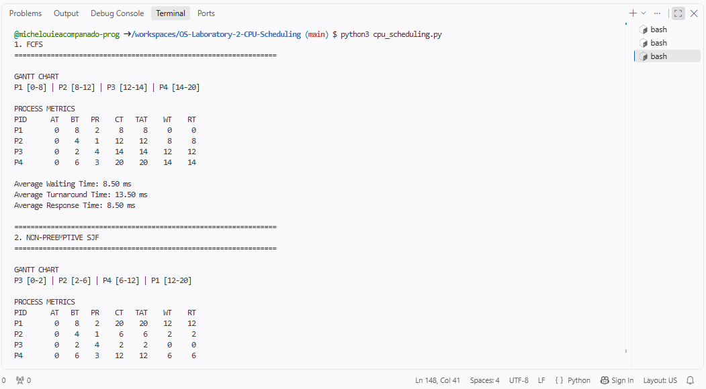

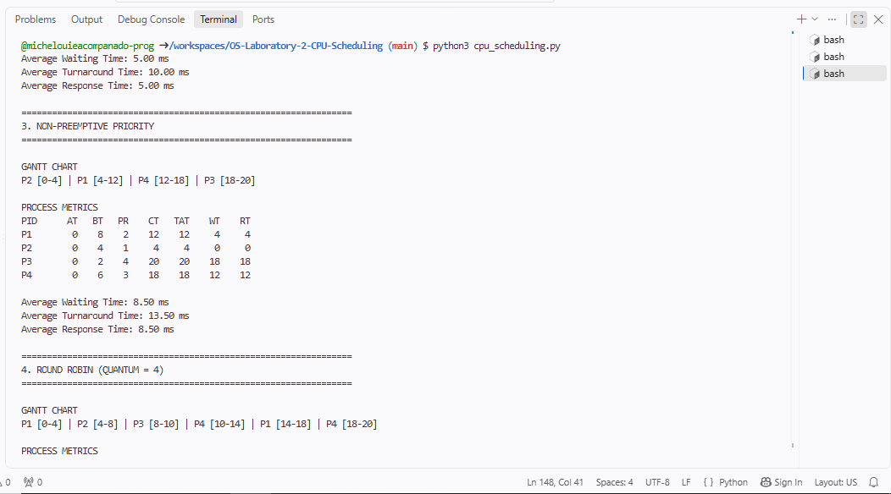

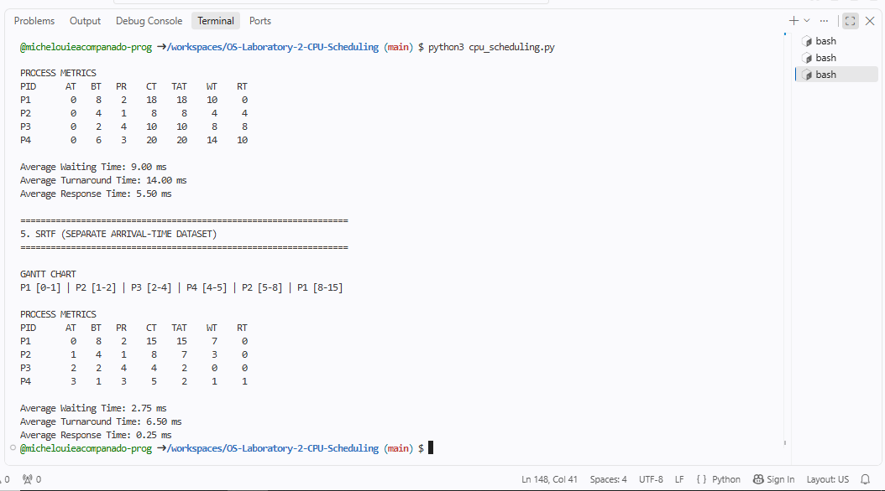

Gantt chart:

```
+-----+-----+-----+-----+-----+-----+
| P1  | P2  | P3  | P4  | P1  | P4  |
+-----+-----+-----+-----+-----+-----+
0     4     8     10    14    18    20
```

| Process | AT | BT | Priority | CT | TAT | WT | RT |
|---|---|---|---|---|---|---|---|
| P1 | 0 | 8 | 2 | 18 | 18 | 10 | 0 |
| P2 | 0 | 4 | 1 | 8 | 8 | 4 | 4 |
| P3 | 0 | 2 | 4 | 10 | 10 | 8 | 8 |
| P4 | 0 | 6 | 3 | 20 | 20 | 14 | 10 |

### Quantum = 1

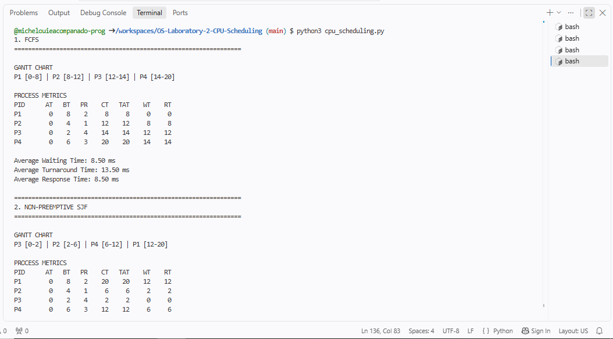

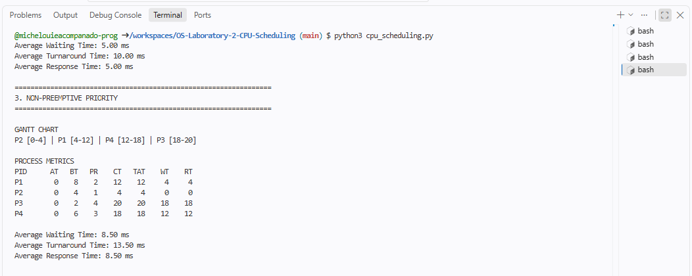

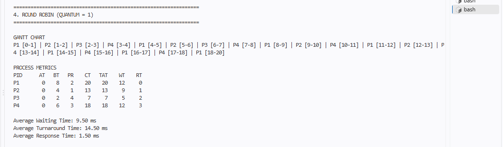

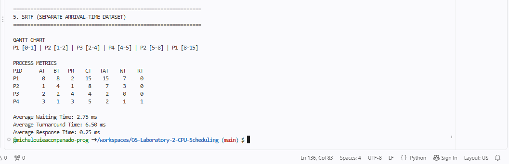

Gantt chart (consecutive 1 ms turns of the same process are drawn as one box, e.g. P1 18–20 is two turns):

```
+-----+-----+-----+-----+-----+-----+-----+-----+-----+-----+-----+-----+-----+-----+-----+-----+-----+-----+-----+
| P1  | P2  | P3  | P4  | P1  | P2  | P3  | P4  | P1  | P2  | P4  | P1  | P2  | P4  | P1  | P4  | P1  | P4  | P1  |
+-----+-----+-----+-----+-----+-----+-----+-----+-----+-----+-----+-----+-----+-----+-----+-----+-----+-----+-----+
0     1     2     3     4     5     6     7     8     9     10    11    12    13    14    15    16    17    18    20
```

| Process | AT | BT | Priority | CT | TAT | WT | RT |
|---|---|---|---|---|---|---|---|
| P1 | 0 | 8 | 2 | 20 | 20 | 12 | 0 |
| P2 | 0 | 4 | 1 | 13 | 13 | 9 | 1 |
| P3 | 0 | 2 | 4 | 7 | 7 | 5 | 2 |
| P4 | 0 | 6 | 3 | 18 | 18 | 12 | 3 |

### Results

| Quantum | CPU allocations | Average WT | Average TAT | Average RT |
|---|---|---|---|---|
| 1 | 20 | 9.50 | 14.50 | 1.50 |
| 2 | 10 | 9.00 | 14.00 | 3.00 |
| 4 | 6 | 9.00 | 14.00 | 5.50 |

### Questions for Step 22

**How does the time quantum affect the number of CPU allocations?**
A smaller quantum means more CPU allocations. With the same 20 ms of total work there were 20 allocations at q = 1, 10 at q = 2 and 6 at q = 4.

**Which quantum produces the lowest average waiting time in your tests?**
q = 2 and q = 4 tie at 9.00 ms. q = 1 is slightly worse at 9.50 ms.

**What happens when the quantum becomes very large?**
Each process finishes in its first turn, so Round Robin behaves like FCFS. Response time gets worse (average RT rose from 1.50 ms at q = 1 to 5.50 ms at q = 4, and would reach the FCFS value of 8.50 ms once the quantum is 8 or more).

**Why can a very small quantum increase context-switching overhead in a real operating system?**
Every time the CPU switches processes the OS must save the running process's state (registers, program counter, etc.) and load the next one. This takes time during which no user work is done. With a tiny quantum the switches happen very often, so more CPU time is wasted on switching. The simulator does not count this cost, but a real OS does.

---

## 8. Step 23 — Modified Process Dataset

Burst times and priorities were changed (arrival times kept at 0 for a fair comparison). The same modified dataset was used for FCFS, SJF, Priority and Round Robin. The SRTF dataset was kept separate and unchanged.

| Process | Arrival Time (AT) | Burst Time (BT) | Priority |
|---|---|---|---|
| P1 | 0 | 6 | 3 |
| P2 | 0 | 3 | 4 |
| P3 | 0 | 7 | 1 |
| P4 | 0 | 2 | 2 |

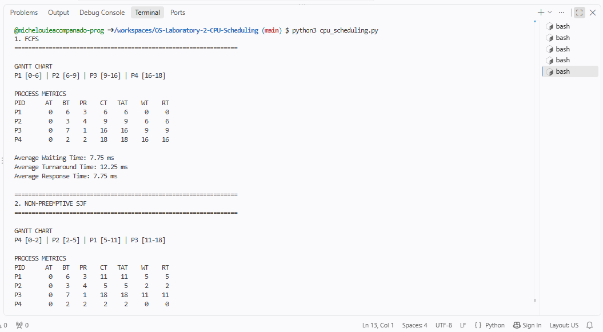

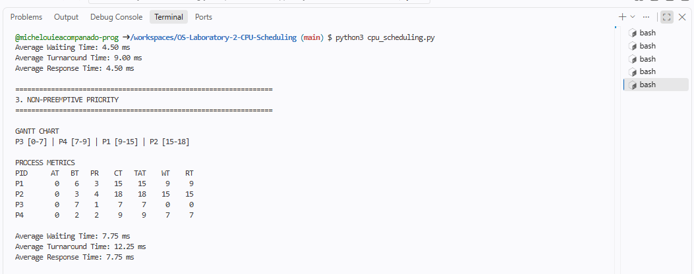

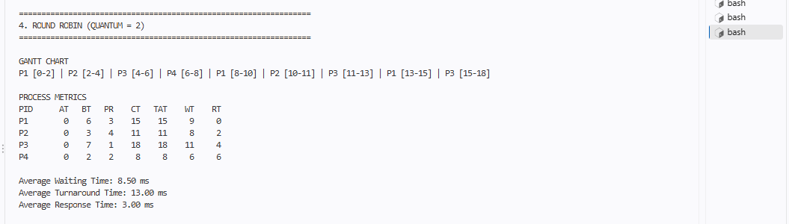

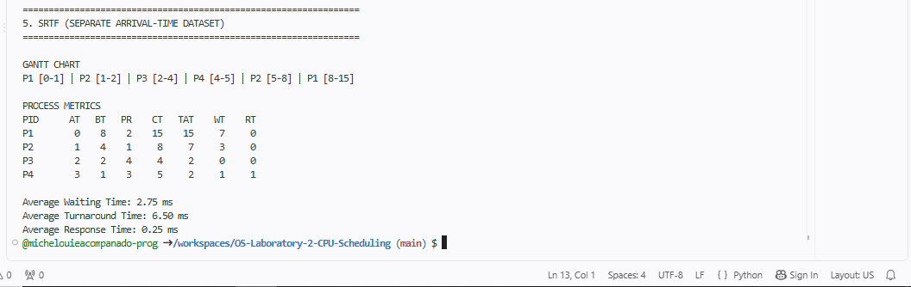

### Gantt charts for the modified dataset

**FCFS** — P1 → P2 → P3 → P4

```
+-----+-----+-----+-----+
| P1  | P2  | P3  | P4  |
+-----+-----+-----+-----+
0     6     9     16    18
```

**SJF** — P4 → P2 → P1 → P3

```
+-----+-----+-----+-----+
| P4  | P2  | P1  | P3  |
+-----+-----+-----+-----+
0     2     5     11    18
```

**Priority** — P3 → P4 → P1 → P2

```
+-----+-----+-----+-----+
| P3  | P4  | P1  | P2  |
+-----+-----+-----+-----+
0     7     9     15    18
```

**Round Robin (q = 2)** — P1 → P2 → P3 → P4 → P1 → P2 → P3 → P1 → P3

```
+-----+-----+-----+-----+-----+-----+-----+-----+-----+
| P1  | P2  | P3  | P4  | P1  | P2  | P3  | P1  | P3  |
+-----+-----+-----+-----+-----+-----+-----+-----+-----+
0     2     4     6     8     10    11    13    15    18
```

### Comparison table of average metrics

| Algorithm | Average WT | Average TAT | Average RT |
|---|---|---|---|
| FCFS | 7.75 ms | 12.25 ms | 7.75 ms |
| SJF | 4.50 ms | 9.00 ms | 4.50 ms |
| Priority | 7.75 ms | 12.25 ms | 7.75 ms |
| Round Robin (q = 2) | 8.50 ms | 13.00 ms | 3.00 ms |
| SRTF (separate dataset) | 2.75 ms | 6.50 ms | 0.25 ms |

_SRTF uses its own arrival-time dataset, so it cannot be compared directly with the other four._

### Per-process results (modified dataset)

**FCFS**

| Process | AT | BT | Priority | CT | TAT | WT | RT |
|---|---|---|---|---|---|---|---|
| P1 | 0 | 6 | 3 | 6 | 6 | 0 | 0 |
| P2 | 0 | 3 | 4 | 9 | 9 | 6 | 6 |
| P3 | 0 | 7 | 1 | 16 | 16 | 9 | 9 |
| P4 | 0 | 2 | 2 | 18 | 18 | 16 | 16 |

**SJF**

| Process | AT | BT | Priority | CT | TAT | WT | RT |
|---|---|---|---|---|---|---|---|
| P1 | 0 | 6 | 3 | 11 | 11 | 5 | 5 |
| P2 | 0 | 3 | 4 | 5 | 5 | 2 | 2 |
| P3 | 0 | 7 | 1 | 18 | 18 | 11 | 11 |
| P4 | 0 | 2 | 2 | 2 | 2 | 0 | 0 |

**Priority**

| Process | AT | BT | Priority | CT | TAT | WT | RT |
|---|---|---|---|---|---|---|---|
| P1 | 0 | 6 | 3 | 15 | 15 | 9 | 9 |
| P2 | 0 | 3 | 4 | 18 | 18 | 15 | 15 |
| P3 | 0 | 7 | 1 | 7 | 7 | 0 | 0 |
| P4 | 0 | 2 | 2 | 9 | 9 | 7 | 7 |

**Round Robin (q = 2)**

| Process | AT | BT | Priority | CT | TAT | WT | RT |
|---|---|---|---|---|---|---|---|
| P1 | 0 | 6 | 3 | 15 | 15 | 9 | 0 |
| P2 | 0 | 3 | 4 | 11 | 11 | 8 | 2 |
| P3 | 0 | 7 | 1 | 18 | 18 | 11 | 4 |
| P4 | 0 | 2 | 2 | 8 | 8 | 6 | 6 |

---

## 9. Part F — Saving the Work to GitHub

Steps done: opened Source Control, reviewed `cpu_scheduling.py`, committed with the message `Implement CPU scheduling algorithms`, and clicked Sync Changes.

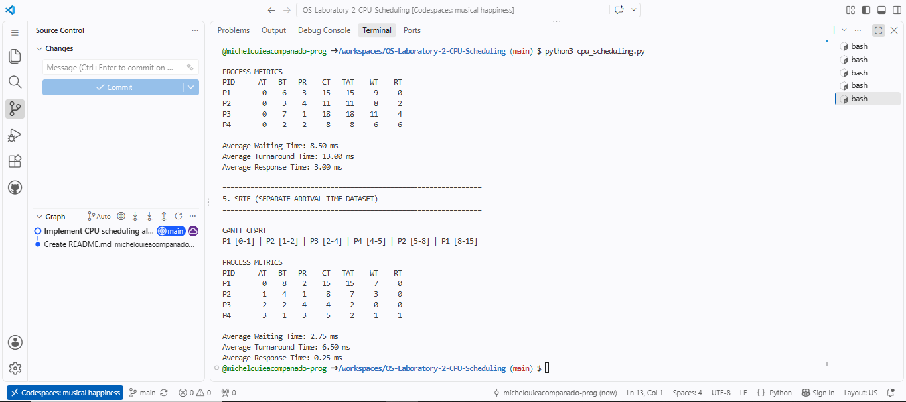

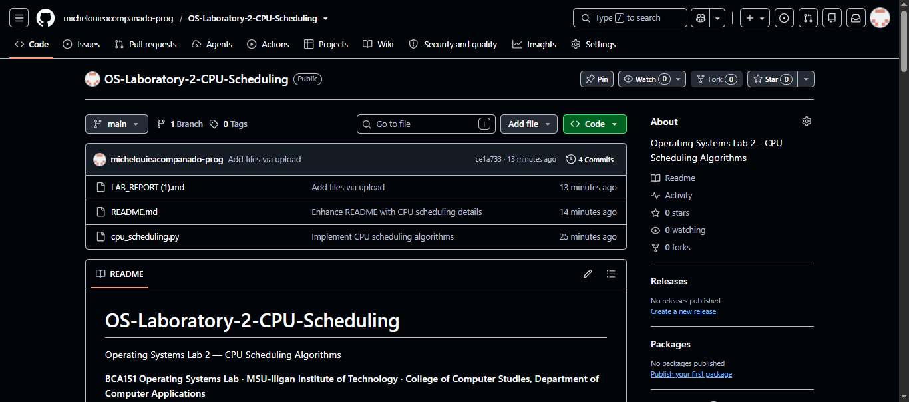

---

## 10. Answers to the Laboratory Questions

**28. What is CPU scheduling, and why is it necessary?**
CPU scheduling is the operating system function that chooses which process in the ready queue gets the CPU next. It is necessary because many processes compete for a limited number of CPUs. Good scheduling keeps the CPU busy, improves throughput and reduces waiting and response times.

**29. What is the difference between FCFS and SJF?**
FCFS runs processes in the order they arrive. SJF runs the process with the shortest burst time first, regardless of arrival order (among those that have arrived).

**30. Why can SJF produce a lower average waiting time than FCFS?**
SJF finishes short jobs first, so fewer processes have to wait behind long jobs. In FCFS a long job at the front delays every process behind it. In the original dataset SJF averaged 5.00 ms waiting time, while FCFS averaged 8.50 ms.

**31. How does Priority Scheduling determine the next process?**
It picks the ready process with the highest priority. In this lab a smaller priority number means higher priority, and ties are broken by arrival time and then process ID. In the non-preemptive version the chosen process runs until it finishes.

**32. What is starvation? Which algorithms can experience it?**
Starvation is when a process waits indefinitely because other processes keep being chosen before it. SJF and SRTF can starve long jobs (shorter jobs keep arriving), and Priority Scheduling can starve low-priority processes. A common fix is aging, which gradually raises the priority of waiting processes. FCFS and Round Robin do not cause starvation.

**33. How does Round Robin improve responsiveness for interactive processes?**
Every ready process gets a turn within a short, bounded time because the CPU is shared in small time slices. Interactive processes therefore get to start quickly. In the original dataset Round Robin had an average response time of 3.00 ms compared with 8.50 ms for FCFS.

**34. What is the effect of changing the Round Robin time quantum?**
A small quantum gives better response time but causes more context switches. A large quantum causes fewer switches but behaves more like FCFS and gives worse response time. In the experiment, average RT was 1.50 ms at q = 1, 3.00 ms at q = 2 and 5.50 ms at q = 4.

**35. How does SRTF differ from non-preemptive SJF?**
SRTF is the preemptive version of SJF. When a new process arrives with a shorter remaining time than the running process, SRTF interrupts the running process and switches. Non-preemptive SJF lets the running process finish first. In the SRTF dataset, P1 was preempted at time 1 by P2 and P2 was preempted at time 2 by P3.

**36. Why do preemptive algorithms require the operating system to save and restore process context?**
A preempted process has not finished and must later continue from exactly where it stopped. The OS therefore saves its context (CPU registers, program counter, stack pointer and other state) in its process control block, and restores it when the process runs again. Without this, the process would lose its progress.

**37. Does the algorithm with the lowest average waiting time always provide the best user experience? Explain.**
No. SJF and SRTF have the lowest average waiting time, but they can starve long processes and may not be fair. Interactive users care more about response time and fairness, and Round Robin gives a better response time even though its average waiting time is higher. The best algorithm depends on the goal of the system.

**38. Why is it important to use the same dataset when comparing algorithms?**
Using the same dataset keeps the input the same, so any difference in the results is caused by the algorithm itself and not by different burst times, arrival times or priorities. This makes the comparison fair.

**39. What role does GitHub play in managing and submitting your laboratory work?**
GitHub stores the source code online, keeps a history of changes through commits, works as a backup, and gives the instructor a link to review the work. GitHub Codespaces also provided the development environment used to write and run the program in the browser.

---

## 11. Brief Analysis

On the original dataset, non-preemptive SJF gave the lowest average waiting time (5.00 ms) and average turnaround time (10.00 ms), because short jobs are completed first. FCFS and non-preemptive Priority tied at 8.50 ms average waiting time, although they ran the processes in different orders. Round Robin had the highest average waiting time (9.00 ms) but by far the best average response time (3.00 ms), since every process got the CPU early. SRTF, run on its own dataset with different arrival times, showed preemption: P1 and P2 were each interrupted by shorter arrivals, giving averages of 2.75 ms waiting time, 6.50 ms turnaround time and 0.25 ms response time.

The Round Robin experiment showed the effect of the quantum: q = 1 gave the best response time (1.50 ms) but needed 20 CPU allocations, while q = 4 needed only 6 but response time rose to 5.50 ms. The modified dataset gave a similar pattern: SJF was lowest in waiting time (4.50 ms), Round Robin was highest in waiting time (8.50 ms) but best in response time (3.00 ms).

---

## 12. Conclusions

In this laboratory activity a CPU scheduling simulator was developed in Python using GitHub Codespaces, and five algorithms were implemented and compared: FCFS, non-preemptive SJF, non-preemptive Priority, Round Robin and SRTF. The program's results matched the reference values and the manual calculations. The results show that no single algorithm is best for every goal: SJF (and SRTF) minimize waiting and turnaround time but can starve long processes, FCFS is simple but lets long jobs delay others, Priority favors important processes but can starve low-priority ones, and Round Robin gives the best response time and fairness at the cost of a higher average waiting time and more context switches. The quantum experiment showed that a smaller quantum improves response time but increases the number of context switches, while a very large quantum makes Round Robin behave like FCFS. Using the same dataset for all algorithms, and committing the code to GitHub, made the comparison fair and the work easy to submit.

---

## Required Deliverables Checklist

- [ ] GitHub repository link (Section 1)
- [ ] Completed Python source code (Section 4)
- [ ] Screenshot of the program running in Codespaces (Section 5)
- [ ] Gantt charts for all five algorithms (Section 6)
- [ ] Calculation tables showing CT, TAT, WT and RT (Section 6)
- [ ] Comparison table of average metrics (Sections 5 and 8)
- [ ] Results of the Round Robin time-quantum experiment (Section 7)
- [ ] Answers to the laboratory questions (Section 10)
- [ ] Brief analysis and conclusion (Sections 11 and 12)
